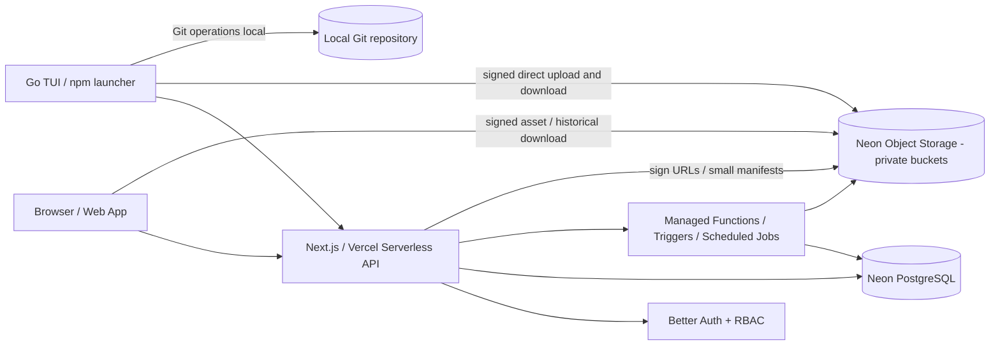
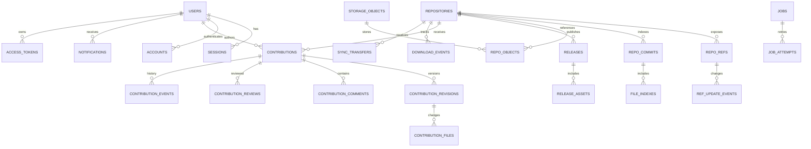

# NYXBERG — Product Requirements Document (PRD) 1.0-Beta

> **Status:** Baseline spesifikasi untuk implementasi; **belum mengklaim fitur sudah dibangun**  
> **Tanggal baseline:** 7 November 2026 (Asia/Jakarta)  
> **Pemilik produk/repo kanonik:** NyxOkkotsu  
> **Target rilis tunggal:** **NyxBerg 1.0-Beta**  
> **Jenis:** Personal Git-backed source hosting + open-source collaboration + browser code explorer + Go TUI  
> **Sasaran deployment:** Vercel + Neon PostgreSQL + Neon Object Storage (atau object store S3-kompatibel yang tervalidasi)  
> **Asal struktur:** ChatPRD default PRD template, diperluas menjadi engineering-ready specification.

## 0. Executive decision record dan batasan tafsir

| ID | Keputusan / kebutuhan yang sudah ditetapkan | Status |
|---|---|---|
| D-01 | **NyxBerg** adalah nama produk; satu-satunya target rilis fitur adalah **1.0-Beta**. Seluruh cakupan yang disetujui di dokumen ini wajib lolos DoD beta. Fase internal ≠ rilis versi produk. | Tetap |
| D-02 | **Hanya akun owner/admin** membuat, menghapus, mengubah repo kanonik, melakukan push langsung, membuat rilis, dan merge. Pengunjung publik tetap bisa membaca dan men-download repo publik. | Tetap |
| D-03 | Pengguna umum bisa daftar/login, punya profil, mengirim kontribusi, komentar, laporan bug, usulan fitur, dan perubahan kode. Akun & metadata disimpan di **Neon PostgreSQL**. | Tetap |
| D-04 | 100% **managed serverless**: tidak ada VPS, daemon Git permanen, Docker container selalu aktif, atau filesystem server yang dianggap persisten. | Tetap |
| D-05 | Web/API: Next.js + TypeScript di Vercel. Metadata/Auth: Neon. Byte repository/artifact: object storage S3-kompatibel; target **≥5 GB storage usable**. | Tetap; biaya dan kuota perlu validasi saat deploy |
| D-06 | CLI ditulis **Go**, berbentuk **TUI-first**: ketik `nyxberg` sekali, selebihnya navigasi menu; distribusi utama `npm install -g nyxberg` dan `npx nyxberg`. | Tetap; ketersediaan nama paket belum dijamin |
| D-07 | Identitas cabang yang ditampilkan boleh imut, termasuk **`mainyaww:3`**; nama ref Git internal wajib valid dan collision-free. | Tetap |
| D-08 | **Contribute** adalah workflow terpadu untuk bug, fitur, dokumentasi, code change, dan laporan keamanan privat; admin saja yang merge. | Tetap |
| D-09 | Pembeda wajib: **Instant Contribute, SourceMap, TimeMachine, RepoHealth, DevCard, RepoPassport**, serta Smart Sync dan TUI. | Tetap |
| D-10 | Repositori memiliki **semantik Git yang sungguhan** (commit DAG, branches, file tree, riwayat, clone/pull/push NyxBerg), **bukan upload ZIP yang menggantikan snapshot setiap push**. | Tetap |
| D-11 | **Protokol Git native (`git push`/`git clone` standar via Smart HTTP/SSH)** bukan sesuatu yang otomatis hadir. Beta wajib mendukung **NyxBerg CLI transport** penuh; interoperabilitas Git native dicantumkan sebagai risiko/keputusan eksplisit, bukan klaim palsu. | Batasan teknis yang disepakati untuk serverless |
| D-12 | Default UI dark-first, khas NyxBerg, dan **setara kualitasnya pada desktop maupun mobile**, termasuk aksesibilitas dan status error. | Tetap |

**Konvensi:** `MUST` = wajib lulus 1.0-Beta; `SHOULD` = pendekatan desain yang disarankan dan boleh diganti jika ada justifikasi teknis setara. `P0/P1/P2` di bawah hanya **urutan pengerjaan**, bukan penghapusan scope atau rencana rilis lain. Angka KPI adalah **ambang acceptance yang diusulkan dalam PRD**, bukan janji vendor.

## 1. TL;DR dan product vision

NyxBerg menyelesaikan masalah platform hosting kode personal yang terasa rumit untuk pemilik dan pendatang baru yang ingin memahami atau memperbaiki sebuah proyek. Pemilik cukup membuka TUI dengan `nyxberg`, memilih file, membuat commit, dan menyinkronkan repository; pengunjung menelusuri kode lewat web dan mengajukan perbaikan lewat Contribute tanpa memerlukan hak tulis ke upstream.

NyxBerg memadukan **Git-backed version history**, **kolaborasi terpadu**, dan **penjelajahan kode visual**, dengan infrastruktur full serverless dan biaya terukur. Produk **bukan pengganti universal GitHub untuk multi-tenant hosting**: owner tunggal mengelola repository utama, sedangkan komunitas berperan sebagai kontributor.

**Positioning:** *NyxBerg — Explore Code. Understand Changes. Contribute Simply.*

**Tiga prinsip pengalaman:** (1) **Explore** dengan SourceMap, kode, README, RepoPassport; (2) **Understand** dengan TimeMachine, diff, RepoHealth; (3) **Contribute** dengan Contribute Hub, Instant Contribute, review/merge aman, dan TUI visual.

## 2. Masalah, peluang, tujuan, dan non-goals

### 2.1 Problem statement

- Owner ingin meng-host proyek sendiri dan mendistribusikan kode/binary tanpa mengelola VPS, bare Git daemon, atau server storage manual.
- Developer umum sering kesulitan memahami struktur dan evolusi kode sebelum memberi kontribusi; issue dan perubahan kode terpisah secara konseptual.
- Operasi `add/commit/push` membutuhkan hafalan sintaks, remote, dan cabang; NyxBerg ingin menurunkan friction melalui menu TUI yang berbasis konteks.
- Serverless membuat Git hosting yang benar-benar menjaga konsistensi branch/commit sulit: upload besar, metadata, refs, concurrency, dan storage harus didesain eksplisit.

### 2.2 Business goals — target evaluasi 1.0-Beta

| Kode | Sasaran | Pengukuran |
|---|---|---|
| G-01 | Jalur owner `init → stage → commit → push → browse` selesai tanpa command Git manual. | E2E test pada semua OS target; tingkat keberhasilan target ≥95% di uji terkontrol |
| G-02 | Jalur kontributor `register → propose → review → merge` berfungsi end-to-end. | E2E yang menghasilkan commit baru, tidak menimpa commit asli tanpa izin |
| G-03 | Semua modul D-01 sampai D-12 dapat diuji dalam satu 1.0-Beta. | 100% acceptance gates MUST lulus |
| G-04 | Total objek dan biaya hosting terpantau; kuota 5 GB dapat dipakai secara aman. | Dashboard quota, peringatan ≥80%/95%, laporan storage dan egress |
| G-05 | Private repo, token, security disclosure, dan branch protection terisolasi. | Negative permission tests: 0 kebocoran data pada kasus uji |

### 2.3 User goals

Owner: upload proyek dengan TUI, mengelola release/branch, memeriksa kontribusi, tidak memelihara server. Kontributor: daftar, memahami kode, melaporkan masalah, mengirim perbaikan, melihat status dan kredit. Guest: mencari repository, melihat kode/README/riwayat/rilis, download cepat tanpa registrasi.

### 2.4 Non-goals yang eksplisit (bukan pemangkasan fitur wajib)

- Menyediakan hosting **repository kanonik milik semua pengguna** / organisasi multi-owner; hanya owner tunggal yang boleh host upstream.
- Meniru seluruh ekosistem GitHub (CI/CD user-supplied code execution, package registry general-purpose, Actions runner, issue tracker terpisah, billing pengguna, social feed/komunitas luas).
- Mengklaim bahwa Git Smart HTTP/SSH standar berfungsi di Vercel tanpa **implementasi dan tes interoperabilitas terpisah**. Ekspor ke Git lokal dan clone via NyxBerg CLI tetap wajib.

## 3. Persona, akses, dan user stories

### 3.1 Persona

| Persona | Masuk | Kebutuhan | Akses |
|---|---|---|---|
| Owner/Admin | Login web/TUI | publish/push/manage repo; review/merge, releases, moderation | Semua repo milik sendiri, operasi admin |
| Registered contributor | Login web/TUI | memahami repo, report/feature/docs/code proposal, notifikasi, DevCard | Baca publik; kontribusi hanya lewat proposal |
| Guest | Tanpa login | browse, search, raw code, clone/download public, RepoPassport | Baca repo publik saja |

### 3.2 User stories dan keterlacakan

- **US-01 (Owner):** Sebagai admin, saya ingin menginisialisasi repo dan menyinkronkan commit melalui menu Go TUI agar tidak menghafal `git add/push`.
- **US-02 (Owner):** Saya ingin branch berlabel `mainyaww:3` sambil tetap mempertahankan Git object DAG yang valid.
- **US-03 (Owner):** Saya ingin mengelola public/private, release, binary, analytics, kuota, dan moderasi dari dashboard.
- **US-04 (Owner):** Saya ingin mengulas patch/diff dari kontributor dan merge tanpa membuka izin push langsung.
- **US-05 (Contributor):** Saya ingin mendaftar akun, verifikasi email, login, dan mengatur profil sehingga karya saya mendapat atribusi.
- **US-06 (Contributor):** Saya ingin melaporkan bug, meminta fitur, atau melaporkan kerentanan privat.
- **US-07 (Contributor):** Saya ingin mengusulkan perubahan lewat editor web/patch tanpa clone lokal, lalu menerima ulasan dan status.
- **US-08 (Contributor):** Saya ingin memantau notifikasi dan menerima kredit saat usulan diterima.
- **US-09 (Guest):** Saya ingin membuka README, struktur file, commit, branch, timeline, dan rilis sebelum mengunduh source/binary.
- **US-10 (Guest):** Saya ingin memahami hubungan file lewat SourceMap dan kondisi pemeliharaan lewat RepoHealth.
- **US-11 (Guest):** Saya ingin menyimpan atau membagikan RepoPassport dengan checksum rilis.
- **US-12 (All):** Saya ingin error yang jelas dan tidak kehilangan pekerjaan ketika offline, konflik, token kedaluwarsa, atau upload terputus.

### 3.3 Matriks izin

| Operasi | Guest | Contributor | Admin |
|---|:---:|:---:|:---:|
| List/read/download **public** repository | ✓ | ✓ | ✓ |
| Baca/download **private** repository | ✕ | ✕ | ✓ |
| Register, login, edit **profil sendiri** | register | ✓ | ✓ |
| Buat/edit/hapus repo kanonik; ubah visibility | ✕ | ✕ | ✓ |
| Push/pull private repo; create/delete refs; releases | ✕ | ✕ | ✓ |
| Clone/pull public dengan NyxBerg CLI | ✓ | ✓ | ✓ |
| Submit/komentar Contribute publik | ✕ | ✓ | ✓ |
| Baca laporan keamanan privat | ✕ | Pelapor sendiri | ✓ |
| Review/approve/reject/merge contribution | ✕ | ✕ | ✓ |
| Tutup laporan **milik sendiri** (kecuali sedang di-review) | ✕ | ✓ | ✓ |
| Moderasi pengguna, tokens, audit/storage admin | ✕ | ✕ | ✓ |

**Enforcement:** setiap operasi dilindungi pada API, signed object URLs, file preview, indeks pencarian, async jobs, dan bukan hanya kondisi tombol UI.

## 4. Functional requirements — seluruhnya wajib dalam 1.0-Beta

Pekerjaan diurutkan P0/P1/P2 hanya untuk dependency engineering. Setiap kriteria adalah kontrak uji.

| ID | Area | Kebutuhan MUST | Acceptance test minimal | Urutan |
|---|---|---|---|---|
| FR-01 | Repo lifecycle | Admin create/edit/delete, slug unik, license, tag, kategori, deskripsi, public/private, pinned. | Guest tidak bisa POST/DELETE; perubahan visibility langsung mengubah akses API/storage. | P0 |
| FR-02 | Explorer | Browser tree, breadcrumb, raw file, copy code, Shiki, sanitized README, penanganan binary. | Render file teks sesuai commit/ref; file biner diberi download tanpa render berbahaya. | P0 |
| FR-03 | Versioning | Commit DAG nyata, parents, tree/blob, refs, tags, branches, file diff, compare, history. | Dua commit pada branch dapat dibandingkan dan direkonstruksi via clone; OID stabil. | P0 |
| FR-04 | CLI sync | NyxBerg custom clone/push/pull, direct upload, resume, conflict, integrity, token. | Test push dari mesin A, clone di B, ubah di B, pull A; commit DAG identik. | P0 |
| FR-05 | Cute branch aliases | Alias display `mainyaww:3`, reversible canonical mapping, valid internal Git ref. | `:` tidak masuk raw Git ref; nama berbeda tidak bertabrakan; rename aman. | P0 |
| FR-06 | Release | Tags, changelog, assets .deb/.rpm/.pkg.tar.zst/.zip, checksum SHA-256, download. | Guest unduh public; asset private tidak bocor; checksum cocok. | P0 |
| FR-07 | Search/analytics | Search, language filter, sorting, pinned, count repository/download/release. | Query paginate; download event tidak membocorkan data pribadi. | P1 |
| FR-08 | Auth/account | Register/login/logout, email verify/reset, username unique, avatar, bio, sessions. | Password hashed; email verify; duplicate username ditolak; revocation efektif. | P0 |
| FR-09 | Authz/admin | Admin tunggal, RBAC, token scope, activity log, moderation, storage dashboard. | Cross-role negative tests dan token revocation lulus. | P0 |
| FR-10 | Contribute | Bug, feature, docs, code, private security; comments, labels, attachments, statuses, events. | Setiap tipe memiliki lifecycle; private security tidak tampil di search. | P0 |
| FR-11 | Instant Contribute | Monaco editor, multi-file proposal, .patch/.diff upload, base commit, diff preview, review. | Kontributor bisa submit patch tanpa push ke upstream; base commit tervalidasi. | P0 |
| FR-12 | Merge | Approve/reject/request changes; konflik; admin merge approved proposal ke Git DAG. | Base lama memicu conflict/rebase; merged commit reachable dari target branch. | P0 |
| FR-13 | Notifications | Notif status, komentar, review, merge, moderation, badge/unread. | User hanya menerima event miliknya; event diulang tidak menggandakan notif. | P1 |
| FR-14 | SourceMap | Graph React Flow; dependency file/modul C/C++, Go, TS, Python; filter/klik/source. | Sampel 4 bahasa divisualisasikan; hubungan dinamis diberi status unknown. | P1 |
| FR-15 | TimeMachine | Timeline commit, browse historical files/README, compare, download, restore aman. | Bisa memilih 2 commit dan meninjau state lama; restore menghasilkan commit baru/tindakan terlacak. | P1 |
| FR-16 | RepoHealth | Nilai dokumentasi, license, maintenance, dependency warning, security findings yang explainable. | Setiap indikator memiliki formula, evidence dan unknown state; tidak mengklaim aman. | P1 |
| FR-17 | DevCard | Profil username/avatar/bio, languages, kontribusi diterima, proyek featured, stats. | Hanya kontribusi `merged`/`resolved` valid dihitung, bukan klaim bebas. | P2 |
| FR-18 | RepoPassport | Kartu share/embed/gambar metadata project, latest release, checksum, link. | Card publik aman untuk share, private repo tidak diekspos; versi checksum terikat asset. | P2 |
| FR-19 | TUI visual | `nyxberg` membuka menu otomatis, repo-detection, stage/commit/branch/sync/contribute/map/time/health. | User melakukan workflow melalui keyboard/menu tanpa Git command yang harus dihafal. | P0 |
| FR-20 | npm packaging | npm global/npx menjalankan binary Go sesuai OS/arch, update notification, checksums. | Install + TUI smoke test di tiap target; optional deps missing ditangani. | P0 |
| FR-21 | Web UX | Distinctive dark-first; responsive desktop/mobile, accessible, loading/empty/errors. | Uji viewport 360px s.d. desktop, keyboard, kontras, forms dan error states. | P1 |
| FR-22 | Ops/security | Backup/restore, quarantine upload, garbage collection, rate limits, audit, recovery. | Fault-injection menguji resume/CAS, dan tidak ada ref yang menunjuk objek belum verified. | P0 |

## 5. User experience dan information architecture

### 5.1 Situs — navigasi & rute konseptual

```
/
/repositories                         katalog, cari/filter, pinned
/repo/{owner}/{slug}                   overview + README + RepoPassport ringkas
/repo/{owner}/{slug}/tree?ref=...      file tree per commit/ref
/repo/{owner}/{slug}/blob?ref=...&path=...  source viewer + edit suggestion
/repo/{owner}/{slug}/commits
/repo/{owner}/{slug}/compare?base=...&head=...
/repo/{owner}/{slug}/branches
/repo/{owner}/{slug}/releases
/repo/{owner}/{slug}/contribute
/repo/{owner}/{slug}/contribute/new
/repo/{owner}/{slug}/contribute/{number}
/repo/{owner}/{slug}/sourcemap?ref=...
/repo/{owner}/{slug}/timemachine
/repo/{owner}/{slug}/health
/repo/{owner}/{slug}/passport
/login  /register  /verify-email  /reset-password
/u/{username}  /settings  /notifications
/admin  /admin/repositories  /admin/contributions
/admin/users  /admin/storage  /admin/audit  /admin/tokens
```

**URI rule:** `path`, `ref`, dan alias branch tidak ditempel ke path yang mudah ambigu; query parameter diberi encoding, divalidasi secara server-side, dan ditampilkan apa adanya setelah decoding aman. Link raw & download private memakai signed URL pendek atau proxy kecil untuk *metadata* saja, bukan mengirim file besar lewat Vercel Functions.

### 5.2 Flow utama web

1. **Guest:** landing → katalog → filter bahasa → repo overview/README → membuka code tree → SourceMap/TimeMachine/RepoHealth → `Download ZIP/TAR.GZ` atau release. Jika repo private, tampil `404`/`403` sesuai kebijakan enumeration, tanpa bocor metadata.
2. **Registrasi contributor:** register → verifikasi email → login → profil → buka repo → Contribute → pilih kategori → tulis laporan/saran. Laporan keamanan selalu masuk channel privat.
3. **Instant Contribute:** login → pilih file → `Suggest Changes` → Monaco Editor dengan diff → tentukan alasan & target base commit → submit → status `OPEN/IN_REVIEW` → review admin → revisi jika diminta → merge admin → notifikasi → DevCard ter-update.
4. **Owner:** login → admin dashboard → create repo → pilih public/private & metadata → TUI push → commit dan file web tercermin → review Contribute → approve/merge → release → cek downloads dan storage.

### 5.3 Desain visual & accessibility

Dark-first, background netral, satu aksen khas NyxBerg, tidak menyalin navigasi GitHub secara literal. Desktop menyediakan sidebar file/explorer dan panel context; mobile menggunakan tabs/drawer, sticky actions terukur, kode dapat scroll horizontal tanpa membuat halaman overflow. Ukuran target sentuh min. 44×44 CSS px; semantic HTML; focus visible; keyboard/tab; ARIA labels; kontras WCAG AA pada teks/action; prefers-reduced-motion; status asynchronous diberi teks (`Uploading 3/8`, `Conflict detected`) alih-alih warna saja. Markdown aman dengan sanitization dan pembatasan HTML; blokir external image yang tidak dipercaya bila diperlukan.

### 5.4 Narrative — pengalaman pengguna

NyxOkkotsu mengembangkan sebuah window manager di Linux. Ia ingin membagikan kode sumber dan paket rilis tanpa mengurus VPS, tetapi tetap ingin orang lain bisa melihat commit, memahami modul, serta mengusulkan perbaikan. Setelah menginstal NyxBerg lewat npm, ia membuka direktori proyek dan menjalankan satu command `nyxberg`. TUI mendeteksi Git repo, menunjukkan file yang berubah, dan menawarkan menu visual untuk memilih perubahan, menulis commit, lalu melakukan Smart Sync. Selama upload berlangsung, CLI menampilkan kemajuan, dan bila koneksi terputus upload dapat dilanjutkan tanpa merusak head branch.

Beberapa hari berikutnya seorang pengguna membuka situs NyxBerg dari ponsel. Ia membaca README, mengeklik SourceMap untuk melihat hubungan `main.c` dan `workspace.c`, lalu memakai TimeMachine untuk mengetahui commit yang memperkenalkan regresi. Karena tidak ingin menginstal tool tambahan, ia mengedit file melalui Instant Contribute di browser, memeriksa diff, kemudian mengirim proposal. Usulannya tercatat di Contribute Hub; ia menerima komentar reviewer dan mengirim revisi. Setelah disetujui, owner melakukan merge yang aman. Riwayat commit baru tampil publik, laporan tertandai resolved, dan DevCard kontributor memperoleh kredit yang bisa ditelusuri. Seluruh proses mempertahankan jejak perubahan, kontrol owner, dan batas biaya penyimpanan yang terlihat.

## 6. Arsitektur teknis target



### 6.1 Stack dan decision rationale

| Layer | Keputusan | Kenapa | Gate implementasi |
|---|---|---|---|
| Web | Next.js App Router + TypeScript + React | URL file explorer, SSR/metadata, integrasi Vercel | Validasi API durasi/memory dan cold-start |
| Design | Tailwind CSS + shadcn/ui + Motion | UI konsisten, responsif, komponen teruji | Audit aksesibilitas |
| Code UX | Shiki, Monaco, React Flow, React Markdown ter-sanitize | Viewer, editor diff, graph | Hati-hati bundle mobile, dynamic import |
| API | Next.js Route Handlers + Zod + explicit API versioning | Control plane kecil dan tegas | Schema validation dan RBAC per route |
| Auth | Better Auth + DB-backed auth/session via Neon | Satu sumber account data | Pilih integrasi managed/manual secara eksplisit, jangan menggandakan dua session systems |
| SQL | Neon PostgreSQL + Drizzle | Strong metadata constraints dan CAS branch refs | Migrasi, connection pooling, transaction semantics |
| Bytes | Neon Object Storage, bucket private S3-compatible | Menampung Git pack, manifests, source assets, patches; tidak lewat DB | Uji multipart/CORS/presign/S3 API support pada endpoint riil |
| Async | Neon Functions/triggers atau Vercel Cron + idempotent queue | Parsing SourceMap, indexing, analytics tanpa VPS | Uji delivery semantics, retry, quotas, worker expiry |
| CLI | Go + Bubble Tea/Bubbles/Lip Gloss | Portabilitas dan dashboard keyboard-first | Native Git dependency & cross-platform test |
| npm | JS shim launcher + precompiled platform packages | User cuma menjalankan `npm i -g nyxberg`, `nyxberg` | Binary packages publik; npm name dan publishing verified |

**Pemisahan control plane vs data plane:** Vercel menerima JSON kecil untuk auth, manifests, workflow, metadata, dan penandatanganan upload/download. Git objects besar, release binaries, dan arsip langsung ditransfer antara klien dengan S3-compatible object storage. Serverless worker memvalidasi secara bertahap dan tidak membangun seluruh repo di RAM pada satu request.

**Buckets minimal:** `nyxberg-private` (Git objects, packs, snapshots/manifests, patches, private attachments) dan opsional `nyxberg-public-assets` (avatar, RepoPassport yang memang ditandai publik). **Default private**. URL signed dengan TTL singkat; izin diberikan setelah pemeriksaan membership/ref/visibility. Hindari kebocoran repo private melalui bucket public-read atau folder naming.

**Infrastruktur provider:** Pada tanggal baseline, blog Neon resmi menyebut Object Storage S3-compatible dan Free plan **5 GB per project**; ada juga Neon Functions/triggers. Itu membenarkan kandidat provider, **bukan jaminan semua S3 API ops/multipart/bandwidth atau harga sesudah limit cocok**. Validasi integration test dan invoice/quota saat implementasi. Vercel mendokumentasikan batas request/response body Functions **4,5 MB**, sehingga dilarang proxy pack/release besar via Route Handler.

### 6.2 Repository consistency & custom synchronization protocol (inti risiko produk)

**Objek logis Git**: `blob`, `tree`, `commit`, `tag`, `ref`; commit punya parent(s), tree root, author/committer metadata, dan signature bila ada. `git` lokal menghasilkan OID sesuai object format repository (`sha1` standar / `sha256` bila didukung); **OID Git dan checksum SHA-256 transport/storage adalah dua konsep berbeda**. Server menyimpan `git_object_format`, `git_oid`, `storage_sha256`, `size`, dan `key` terpisah. Klien bukan sumber kebenaran tunggal untuk validitas objek.

**Strategi storage**: obyek berbasis hash disimpan secara immutable; untuk efisiensi transfer, packfile Git yang valid dapat diunggah menjadi objek besar (atau chunks) dengan index/manifest verifiable. Database menautkan objek/pack ke commit yang reachable. Tidak membuat ZIP penuh tiap push. Untuk download ZIP historical, generate artifact on demand via proses bounded dan cache hasil, atau streaming dari manifest dengan batas jelas. Jangan mengasumsikan satu function dapat mengemas repo besar tanpa limit.

**Nama branch kustom:** display alias `mainyaww:3` disimpan terpisah dari internal ref Git. Implementasi yang direkomendasikan: `refs/heads/nyxb/<base64url(UTF-8 displayName)>`, validasi dengan `git check-ref-format` dan normalisasi Unicode yang didefinisikan. Encode reversible, unik, case-sensitive; index `UNIQUE(repo_id, display_branch_name)` dan `UNIQUE(repo_id, git_ref_name)`; reserved internal namespace disegel. Klien harus memahami bahwa Git CLI lokal akan melihat ref encoded; TUI menampilkan display alias. `mainyaww:3` default alias di CLI/web, bukan Git native ref.

**Alur owner push (state machine yang dapat di-retry):**

1. TUI mendeteksi perubahan Git lokal, menghitung reachable graph dari commit baru, dan mengambil head+generation remote.
2. API `sync/negotiate` mengautentikasi `repo:write` milik ADMIN, mengembalikan missing objects/packs, capability format, transfer ID, dan **expected head OID + generation**; idempotency key wajib.
3. TUI membuat pack data dari Git lokal, mentransfer chunk lewat **signed multipart** ke staging keys; setiap part & manifest diverifikasi checksum, ukuran, count, dan batas kuota. Retry/resume per transfer; nama objek immutable.
4. API `sync/finalize-upload` merekam manifest pada state `UPLOADED/PENDING_VERIFICATION`; worker bounded memverifikasi pack format, object OIDs, commit/tree DAG reachable, nama ref, batas size dan policy. Jika tidak feasible untuk serverless dalam batas fungsi, kerja diverifikasi bertahap dengan chunk/checkpoint, bukan menerima commit tidak terverifikasi.
5. API `sync/update-ref` hanya menerima transfer berstatus `VERIFIED`, memastikan seluruh reachable objects siap di storage, memeriksa ACL+branch protection, menjalankan **atomic SQL CAS**: `UPDATE repo_refs SET head_oid=:new, generation=generation+1 WHERE repo_id=:id AND ref=:ref AND head_oid IS NOT DISTINCT FROM :expected AND generation=:expected_gen`; 0 rows → HTTP `409 REF_CONFLICT`. Simpan `ref_update_events` dan outbox indexing di satu transaksi.
6. Setelah transaksi commit, publik dapat membaca ref baru; background indexer memperbarui file tree, search, SourceMap, metrics. Indeks boleh eventual-consistent, **ref & manifest tidak boleh menunjuk data hilang**.
7. Upload terputus tidak mengubah refs. Staging upload/objects orphan dibersihkan setelah TTL melalui job idempotent dengan grace period; jangan hapus object yang masih direferensikan branch atau release.

**Flow clone:** CLI memperoleh refs/format/manifest dari API; mengunduh pack langsung via signed GET (resumable), memverifikasi hash & OID, menjalankan `git index-pack`/equivalent secara lokal, membuat Git repo dan valid refs, checkout target, menyimpan remote NyxBerg config. Kontributor/guest bisa clone hanya repo publik; private hanya ADMIN. **`nyxberg clone` harus menghasilkan riwayat Git lokal yang dapat dipakai `git log`**.

**Flow pull:** fetch object delta, tentukan apakah fast-forward; bila diverged tampil opsi guided merge/rebase/cancel yang aman. Jangan melakukan force rewrite. Konflik menampilkan file + status, mengizinkan manual resolution lokal, melanjutkan operasi sesudah resolusi; owner tanpa permission ditolak di tahap publish.

**Fast-forward default:** `push` non-fast-forward wajib ditolak; tidak ada force push sebagai jalan pintas dalam beta. Release tag immutable kecuali operasi admin eksplisit melalui audit + confirmation; hapus branch membutuhkan konfirmasi ganda jika protected.

**Invariant yang harus selalu berlaku:**

- `head(ref)` menunjuk commit valid dan semua objek reachable tersedia serta lolos verifikasi.
- Commit DAG immutable; metadata DB dapat direkonstruksi dari objek asli.
- Satu update head linearizable per ref; concurrent push menghasilkan satu sukses + satu conflict yang jelas.
- File private tidak bisa diambil hanya karena mengetahui object key/hash.
- Tidak ada endpoint yang memakai repo slug saja sebagai bukti kewenangan.

### 6.3 Contribution merge algorithm

Kontributor mengirim **proposal immutable per revision**, berisi `base_commit_oid`, `target_ref`, path normalization, patch/resulting blobs, metadata author, dan komentar. Proposal **tidak melakukan write** ke branch owner.

Admin review latest proposal revision → pilih `approve` → sistem menghitung konflik terhadap **current head**. Jika current head == base, patch di-apply terhadap tree base dan commit baru dibuat (identity attribution jelas), lalu menjalankan verified-object upload + CAS ref yang sama seperti owner push. Jika current head berubah, coba deterministic three-way merge dengan Git semantics di klien admin atau bounded trusted worker; bila konflik tandai `CHANGES_REQUESTED`/`CONFLICT` dan tampil file conflict. Tidak menulis perubahan yang belum tervalidasi.

**Beta end-to-end**: admin-assisted merge lewat TUI boleh digunakan untuk pekerjaan Git berat; UI tetap menyajikan status, review, dan tautan commit yang sudah merged. Tidak boleh mengubah tombol `Merged` tanpa commit reachable dari target ref. Review policy: hanya admin yang approve/reject; tidak bisa approve draft proposal yang dihapus, expired, atau terhadap ref yang tidak dikenal.

### 6.4 Status lifecycle (discriminated state machine)

| Jenis | State valid (contoh) | Terminal | Aturan |
|---|---|---|---|
| Bug / feature / docs request | `OPEN → TRIAGED → IN_PROGRESS → RESOLVED` / `CLOSED` | RESOLVED, CLOSED | Bisa link ke code proposal; laporan security tidak masuk daftar ini |
| Code contribution | `DRAFT → OPEN → IN_REVIEW → CHANGES_REQUESTED → IN_REVIEW → APPROVED → MERGING → MERGED` atau `CLOSED/REJECTED` | MERGED, CLOSED, REJECTED | `APPROVED` tidak otomatis `MERGED`; head conflict balik ke review |
| Private security report | `OPEN → TRIAGED → IN_REVIEW → RESOLVED/CLOSED` | RESOLVED, CLOSED | Private metadata, body, attachments, notifikasi, audit |

Satu `Contribute Hub` menampilkan timeline gabungan; tiap tipe punya valid transitions dan properti tersendiri. Tidak memaksa bug report melalui `MERGED` jika penyelesaiannya bukan commit.

## 7. Database logical ERD dan skema



### 7.1 Inti tabel, PK/FK, batasan dan indeks

| Table | Kolom wajib penting | Constraints/indeks penting |
|---|---|---|
| `users` | `id uuid PK`, `username`, `email`, `email_verified_at`, `password_hash`/auth linkage, `role`, `bio`, `avatar_key`, `created_at` | unique normalized username/email; role CHECK (`ADMIN`,`CONTRIBUTOR`) |
| `accounts`, `sessions`, `verifications` | skema adapter Better Auth, `user_id`, provider/session token hash, expiry | TTL cleanup; never expose token; FK cascade sesuai adaptor |
| `repositories` | `id uuid`, `owner_id`, `slug`, `name`, `description`, `visibility`, `language`, `license`, `default_ref_id`, `deleted_at` | unique `(owner_id,lower(slug))`; owner constrained ADMIN; filter visibility+updated_at |
| `repo_refs` | `id`, `repo_id`, `display_name`, `git_ref`, `kind`, `head_oid`, `generation`, `protected` | unique `(repo_id,display_name)` dan `(repo_id,git_ref)`; CAS generation |
| `repo_commits` | `(repo_id,oid) PK`, `tree_oid`, `author`, `committer`, `message`, `committed_at`, `object_format` | parent adjacency table `commit_parents`; index repo/time |
| `storage_objects` | `id`, `bucket`, `key`, `storage_sha256`, `size`, `status`, `verified_at`, `created_at` | unique bucket+key; immutable verified content; `status` transitions |
| `repo_objects` | `repo_id`, `git_oid`, `object_type`, `object_format`, `storage_object_id`, `pack_offset` | unique `(repo_id,object_format,git_oid)`; ensure pack index checks |
| `repo_manifests` | `repo_id`, `ref/head_oid`, `pack_set`, `created_at`, `verified` | manifest keyed by version/root hash; ref only points verified |
| `sync_transfers` | `id`, `repo_id`, `actor_id`, `expected_head`, `expected_generation`, `idempotency_key`, `state`, `bytes` | unique actor+idempotency; cleanup TTL |
| `ref_update_events` | `repo_id`, `ref_id`, `before_oid`, `after_oid`, `actor_id`, `at`, `reason` | append-only, sorted index |
| `file_indexes` | `repo_id`, `commit_oid`, `path`, `blob_oid`, `mime`, `size`, `language` | unique `(repo_id,commit_oid,path)`; path validated; index by directory |
| `repository_languages` | `repo_id`, `language`, `bytes` | unique repo+language |
| `releases` | `id`, `repo_id`, `tag_name`, `commit_oid`, `title`, `changelog`, `published_at` | unique repo+tag; append-only audit |
| `release_assets` | `release_id`, `storage_object_id`, `filename`, `size`, `sha256`, `download_count` | unique release+name; private ACL inherited |
| `contributions` | `id`, `repo_id`, `number`, `author_id`, `type`, `visibility`, `title`, `body`, `status`, `target_ref`, `created_at` | unique repo+number; status transition check; private report policy |
| `contribution_revisions` | `id`, `contribution_id`, `revision_no`, `base_commit_oid`, `proposed_tree_oid`, `created_at`, `upload_status` | unique contribution+revision_no; immutable submitted revisions |
| `contribution_files` | `revision_id`, `path`, `old_blob_oid`, `new_blob_oid`, `patch_object_id`, `change_type` | normalized path, no `../` |
| `contribution_comments` | `id`, `contribution_id`, `author_id`, `body`, `created_at`, `deleted_at` | index contribution/time; sanitized render |
| `contribution_reviews` | `id`, `contribution_id`, `revision_id`, `reviewer_id`, `decision`, `body`, `at` | reviewer ADMIN required; tied to revision |
| `contribution_labels` + `labels` | `contribution_id`, `label_id`; repo-scoped label name | unique repo+label, unique pair |
| `contribution_events` | `id`, `contribution_id`, `actor_id`, `action`, `from_state`, `to_state`, `created_at` | append-only audit/time index |
| `contribution_attachments` | `contribution_id`, `object_id`, `visibility`, `filename`, `mime` | security report private; size limits |
| `notifications` | `id`, `recipient_id`, `type`, `resource_id`, `read_at`, `created_at`, `dedupe_key` | unique recipient+dedupe; index unread |
| `access_tokens` | `id`, `user_id`, `prefix`, `token_hash`, `scopes`, `expires_at`, `revoked_at` | constant-time hash check; no plaintext retrieval |
| `download_events` | `id`, `repo_id`, `asset_id`, `kind`, `at`, `approx_country?` | retention; no raw IP indefinitely |
| `audit_logs` | `actor_id`, `resource`, `action`, `before`, `after`, `request_id`, `at` | append-only; redact tokens/secrets |
| `jobs`, `job_attempts` | `kind`, `payload_ref`, `idempotency_key`, `state`, `lease_until`, `attempt`, `error_code` | unique idempotency, retry/backoff, dead letter |
| `repo_health_snapshots` | `repo_id`, `commit_oid`, `metrics_json`, `analyzer_versions`, `status` | unique repo+commit+analyzer set |
| `source_graphs` | `repo_id`, `commit_oid`, `language`, `graph_object_id`, `analysis_status` | cache by commit, no recompute per page view |
| `repopassport_cache` | `repo_id`, `release_id?`, `card_object_id`, `generated_at` | invalidate on public metadata/release change |

**Database policy:** semua FK memakai ON DELETE sesuai data retention policy (soft delete repo, delayed GC; account deletion perlu audit/anonymization). Immutable Git objects tidak diubah lewat `UPDATE`. DB hanya menyimpan metadata dan index; binary source code tidak disimpan sebagai giant BYTEA.

## 8. API contract v1 — struktur dan contoh

Seluruh endpoint aplikasi memakai namespace `/api/v1`, JSON UTF-8 dan kontrak error standar. Semua write mendukung CSRF protection untuk cookie session, scope-based Bearer untuk CLI, request size limit, rate limiting, serta idempotency untuk transfer/merge/release.

### 8.1 Endpoint inti

| Method + path | Caller | Input utama | Output/aksi | Error penting |
|---|---|---|---|---|
| `POST /auth/*` | publik/user | Better Auth flows | sessions/verifications | 400/401/409/429 |
| `GET /repos` | semua | `q,lang,sort,cursor,limit` | public repo page; private admin if authorized | 400/429 |
| `POST /repos` | ADMIN | `name,slug,visibility,license` | repo ID, default alias/ref | 401/403/409 |
| `PATCH /repos/{id}` / `DELETE /repos/{id}` | ADMIN | metadata, confirm token | update/soft delete | 403/409 |
| `GET /repos/{id}/refs` | semua sesuai visibility | query `kind` | display/internal mapping & heads | 403/404 |
| `GET /repos/{id}/tree` | read | `ref,dir,cursor` | tree entries at exact commit/ref | 404/422 |
| `GET /repos/{id}/blob` | read | `ref,path` | metadata + signed GET / bounded text preview | 403/404/413 |
| `GET /repos/{id}/commits` / `compare` | read | `ref,base,head,cursor` | OIDs, parents, summaries, files | 422 |
| `GET /repos/{id}/archive` | read | `commitOid,format` | short-lived signed cached archive / processing status | 202/404 |
| `GET/POST /repos/{id}/releases` | read/ADMIN | tag, commit, changelog | release summary | 403/409 |
| `POST /repos/{id}/assets/presign` | ADMIN | name,size,mime,hash | upload session/signed parts | 403/413/422 |
| `POST /repos/{id}/sync/negotiate` | ADMIN for write; read for clone | client refs/capabilities, expected head | missing pack/object manifests, transfer session | 401/403/409 |
| `POST /repos/{id}/sync/complete-upload` | ADMIN | `transferId,parts,manifest` | `PENDING_VERIFICATION` | 400/403/422 |
| `GET /sync/transfers/{id}` | originator | transfer state/progress | resumable session | 401/403/404 |
| `POST /repos/{id}/sync/update-ref` | ADMIN | expected head+generation,new head, verified transfer | new head+generation | **409 REF_CONFLICT** |
| `GET/POST /repos/{id}/contributions` | read / contributor | type,title,body,base,target | list or new numbered contribution | 401/403/422 |
| `GET/PATCH /contributions/{id}` | owner/author by policy | status/content | contribution details | 403/409 |
| `POST /contributions/{id}/revisions` | author | files,base commit,patch refs | immutable revision, validation status | 409 STALE_BASE |
| `POST /contributions/{id}/comments` | contributor | text | comment | 403/429 |
| `POST /contributions/{id}/reviews` | ADMIN | revision,decision,body | reviewed state | 403/409 |
| `POST /contributions/{id}/merge` | ADMIN | revision,expected head,idempotency | job/commit result | 409 CONFLICT |
| `GET /repos/{id}/sourcemap` | authorized read | commit/lang/filter | cached graph or 202 job state | 202/404 |
| `GET /repos/{id}/timemachine` | authorized read | range/cursor | commit timeline | 400 |
| `GET /repos/{id}/health` | authorized read | commit | metrics+evidence+unknowns | 202 |
| `GET /repos/{id}/passport` | public only | `format=svg/png/json` | shareable card | 404 |
| `GET /notifications` / `PATCH /notifications/{id}` | logged-in | cursor, read status | user-specific messages | 401/403 |
| `GET /admin/storage` / `GET /admin/audit` | ADMIN | range/cursor | protected dashboard data | 403 |

### 8.2 Wire contracts — contoh representatif

**Create repo**

```http
POST /api/v1/repos
Authorization: Bearer <ADMIN_SCOPED_TOKEN>
Content-Type: application/json
Idempotency-Key: <uuid>

{"name":"nyxwm","slug":"nyxwm","visibility":"PUBLIC","defaultBranchDisplayName":"mainyaww:3","license":"MIT"}
```

```json
{"id":"repo_uuid","slug":"nyxwm","visibility":"PUBLIC","defaultRef":{"displayName":"mainyaww:3","gitRef":"refs/heads/nyxb/bWFpbnlhd3c6Mw","headOid":null,"generation":0}}
```

**Atomic head update:**

```http
POST /api/v1/repos/repo_uuid/sync/update-ref
Authorization: Bearer <ADMIN_SCOPED_TOKEN>
Content-Type: application/json
Idempotency-Key: <uuid>

{"gitRef":"refs/heads/nyxb/bWFpbnlhd3c6Mw","expectedHeadOid":"old_oid","expectedGeneration":7,"newHeadOid":"new_oid","transferId":"transfer_uuid"}
```

```json
{"gitRef":"refs/heads/nyxb/bWFpbnlhd3c6Mw","headOid":"new_oid","generation":8,"status":"COMMITTED"}
```

**Failure schema:**

```json
{"error":{"code":"REF_CONFLICT","message":"Remote branch changed since negotiation","requestId":"req_uuid","retryable":false,"details":{"currentGeneration":8}}}
```

Other typed codes: `AUTH_REQUIRED`, `FORBIDDEN`, `REPO_NOT_FOUND`, `PRIVATE_RESOURCE`, `QUOTA_EXCEEDED`, `INVALID_REF`, `UNVERIFIED_OBJECT`, `TRANSFER_EXPIRED`, `PATCH_INVALID`, `STALE_BASE`, `MERGE_CONFLICT`, `RATE_LIMITED`, `RETRY_LATER`, `DEPENDENCY_UNAVAILABLE`. Do not return raw stack traces or sensitive object keys.

**API contract rules:** `limit` clamped to 1–100; cursor opaque; `requestId` propagated from CLI UI; all callbacks/jobs idempotent; signed upload/download URLs have least privilege, short TTL, and digest/size binding where supported. Logs exclude bearer tokens, cookie, reset token, and security report body.

## 9. TUI/CLI UX dan npm distribution — detail implementasi

### 9.1 Command entry dan state navigation

**Satu entrypoint wajib:** `nyxberg` (tanpa parameter). Argumen noninteraktif internal seperti `--version`, `--help`, `--diagnose` boleh tersedia untuk debugging, tetapi semua tindakan user utama **harus bisa** dilakukan tanpa menghafalnya.

```text
┌──────────────────────────────────────────────┐
│ NYXBERG                                    :3 │
│ 1.0-Beta    NyxOkkotsu                       │
├──────────────────────────────────────────────┤
│ Repository: nyxwm                            │
│ Branch: mainyaww:3   4 changed   Synced: No  │
│                                              │
│ > Smart Sync                                 │
│   Stage / Unstage Files                      │
│   Commit Changes                             │
│   Push / Pull                                │
│   Branches & History                         │
│   Release Manager                            │
│   Contribute Hub                             │
│   SourceMap / TimeMachine / RepoHealth       │
│   Repository Manager                         │
│   Settings / Account                         │
├──────────────────────────────────────────────┤
│ ↑↓ Move · Enter Select · Space Toggle · Esc Back │
└──────────────────────────────────────────────┘
```

**Detection:** TUI memeriksa cwd ke atas sampai root Git repo, memastikan metadata `.git` valid, mengecek konfigurasi remote NyxBerg di file khusus (mis. `.nyxberg/config.toml`), dan menjalankan `git status --porcelain=v2`. Bila tidak ada repo tampil menu `Initialize / Clone / Browse Public / Login`. Bila repo tanpa NyxBerg remote tampil `Link existing repository` dengan preview. Bila belum login dan ingin push/create, arahkan ke device auth flow.

**UI state machine:** `BOOT → DETECT_REPO → UNAUTH/READY → MENU → WORKFLOW → PREVIEW/CONFIRM → EXECUTING → VERIFIED/ERROR → MENU`. Panah ↑↓ navigasi, Tab/Shift+Tab pindah fokus form, Enter pilih, Space checkbox, Esc back, Q keluar dari root (bukan saat mengetik). Ctrl+C graceful cleanup. Sesuaikan lebar terminal (minimal target 80×24; di bawah target tampil compact fallback). Screenshot ASCII bukan piksel final.

### 9.2 Stage → Commit → Push dan Smart Sync

- **Stage screen:** list `modified/untracked/deleted/renamed` dengan checkbox, filter, `select all`, staged status, file stats, diff view; path dengan spasi/Unicode harus benar.
- **Commit form:** commit message wajib non-empty, ringkasan file, perubahan +/−, author identitas lokal, penanda branch alias, confirmation; commit dibuat via Git lokal dan `git log` benar.
- **Push:** tampil target repo/ref, expected remote head, estimasi bytes, progress part, cancel yang aman, pause/resume; jika 409 conflict, user diberi pilihan `Pull & Review`, `View Diff`, `Cancel`, bukan force overwrite.
- **Smart Sync:** check repo status → fetch remote metadata → review/select stage → commit (jika ada perubahan) → cek remote ancestor/fast-forward → direct upload → finalize+verify → CAS head → final integrity check. Jika local file masih dirty ketika pull, pertahankan working tree; tidak menjalankan operasi destruktif diam-diam.
- **Contribute via TUI:** cari repo publik → pilih `Report Bug`, `Feature Request`, `Code Proposal` atau `My Contributions`; TUI dapat menautkan patch dari Git working branch, tetapi submission tidak menjadi push upstream.
- **Other modules:** SourceMap/TimeMachine/health TUI dapat menampilkan ringkasan tabel dan membuka halaman web spesifik dengan URL aman; untuk versi beta, navigasi tetap tersedia di menu (bukan janji full graph ASCII).

### 9.3 Autentikasi CLI

Gunakan browser-based device/PKCE flow: TUI meminta pairing session dari API, membuka URL verifikasi, polling singkat dengan backoff sampai authorized, dan menerima token scoped `repo:read`, `repo:write` (ADMIN only), `contribute:create`, `contribute:read`, `profile:read`. Jika browser tidak terbuka, tampilkan kode pairing + URL. Refresh/revoke via OS credential store (Keychain, Credential Manager, Secret Service); fallback local file hanya bila permissions aman dan user diberi peringatan. Token tidak ditampilkan kembali di layar/log. Semua operasi dengan token revoked mengembalikan sign-in action, bukan gagal tanpa penjelasan.

### 9.4 npm packaging dan versi

```
packages/
  nyxberg/                 # package publik: bin/nyxberg.js launcher
  nyxberg-linux-x64/       # compiled Go ELF
  nyxberg-linux-arm64/
  nyxberg-linux-x64-musl/  # optional bila target musl disetujui
  nyxberg-linux-arm64-musl/
  nyxberg-win32-x64/
  nyxberg-darwin-x64/
  nyxberg-darwin-arm64/
cli/
  cmd/nyxberg/main.go
  internal/tui/
  internal/git/
  internal/sync/
  internal/auth/
  internal/config/
  internal/api/
```

Top-level `package.json` punya `bin: { "nyxberg": "./bin/nyxberg.js" }` dan `optionalDependencies` ke platform packages dengan `os`, `cpu`, serta `libc` jika diperlukan. Launcher mencari binary sesuai `process.platform/arch`, memverifikasi file yang terpasang, lalu `spawn` dengan stdio inherited dan signal handling; tidak menjalankan download binary tak diverifikasi dari postinstall script. `npm install -g nyxberg`, `npx nyxberg`; juga sediakan artefak Go standalone ter-sign/checksum. **Nama paket `nyxberg` dan scope `@nyxberg/*` belum divalidasi kepemilikannya.**

**Perbedaan product version vs npm SemVer:** nama rilis produk tetap **1.0-Beta**. npm memerlukan SemVer valid, misal `1.0.0-beta.1` untuk build candidate, lalu `1.0.0-beta.2` jika memperbaiki bug sebelum beta dinyatakan selesai. Ini **bukan** roadmap modul `v0.1, v0.2` dan tidak mengizinkan fitur wajib ditunda. Gunakan prerelease dist-tag `beta` agar tidak mengubah `latest` secara tak sengaja.

**Release packaging CI:** lint/test Go → compile target matrix dengan deterministic flags → checksum binaries → `npm pack` dan test paket per OS → publish platform packages lalu launcher (OTP/publisher auth dan provenance bila tersedia) → smoke test `npx` → changelog/update notification dari metadata rilis yang tepercaya. Saat binary tidak ada, launcher menampilkan unsupported/optional dependencies error dengan petunjuk perbaikan.

## 10. Unique feature design contracts

### 10.1 SourceMap

Input: `repo_id, commit_oid, supported_language`. Parser deterministik mengekstrak `from_file, to_file/module, relation_type, line, confidence, unresolved_reason`. C/C++ `#include`/compile context, Go imports, TS imports/exports, Python import graph; **dengan label** bahwa macro, conditional compile, reflection, dynamic imports, generated files, monorepo aliases dan runtime dependencies mungkin tidak terekstrak akurat. Output graph JSON disimpan di object storage, index job di Neon (`READY/PARTIAL/FAILED`). React Flow memvisualisasikan node/edge, pencarian, kelompok direktori, panel detail dengan jump-to-file, dan link `Suggest Changes`. Jangan tampilkan grafik yang mengklaim kepastian saat parser tidak tahu. Batas file/node/edge dipublikasikan di UI; bila repo terlalu besar, graph dibuat per folder dan menampilkan alasan truncated.

**AC-SM1:** fixture C/C++, Go, TS, Python menampilkan edge yang dapat dicek terhadap source. **AC-SM2:** graph cached per commit hash; reload tidak mengulang parsing mahal. **AC-SM3:** private source graph tidak bisa di-fetch guest.

### 10.2 TimeMachine

UI slider/timeline commit dengan tanggal, author, ringkasan perubahan, penanda release; pilihan commit A/B menampilkan file tree dan diff. README lama dirender dari commit terkait, bukan dari head terbaru. Restore **tidak menghapus history**: gunakan aksi admin yang membuat commit revert atau memindahkan branch dengan konfirmasi dan audit sesuai policy (prefer commit revert); pemulihan file tertentu boleh menghasilkan commit baru. Archive old revision dibuat/cached per commit dan bisa diunduh Guest dari public repo.

**AC-TM1:** repo dua commit historis bisa dibandingkan konsisten. **AC-TM2:** restore tidak menghilangkan commit lama. **AC-TM3:** bila snapshot belum di-cache, tampil `Preparing Archive` dengan status background, tanpa request menggantung.

### 10.3 RepoHealth

Setiap metrik mengandung `value`, `label`, `evidence`, `analyzer_version`, `checked_at`, `status=(PASS|WARN|FAIL|UNKNOWN)`. Contoh: docs memiliki README, license file; maintenance last-commit (bukan indikasi kualitas mutlak), backlog laporan; dependency warning memakai parser manifest+advisory feed yang sah dan cache; security check pasif (secret patterns, lockfile vulnerabilities jika data tersedia). Jangan menjalankan `npm install`/script dari source tidak dipercaya di server. `UNKNOWN` dihitung terpisah, **bukan** otomatis skor 100. Formula dan keterbatasan bisa dilihat pengguna.

**AC-H1:** semua score dapat ditelusuri bukti per commit; **AC-H2:** unavailable scanner → UNKNOWN; **AC-H3:** tidak ada klaim program aman karena skor tinggi.

### 10.4 DevCard

Card menampilkan avatar, bio, languages, featured projects (karya owner / proyek yang disetujui untuk tampil), bug reports `resolved`, merged proposals, docs improvements diterima. UI tidak membandingkan penampilan fisik, jumlah pengikut, atau ranking agresif. Kontribusi privat hanya muncul dalam statistik apabila memang aman dan dengan persetujuan (default tidak). **AC-DC1:** angka stats cocok dengan query DB; tidak menghitung proposal yang hanya approved tetapi belum merged.

### 10.5 RepoPassport

Generasi image/SVG server-side dari safe metadata: nama, pemilik, bahasa, lisensi, platform, latest release/tag, timestamp, badge health status bila sudah dianalisis, QR/link repository, checksum asset terkait. Embed URL hanya untuk repo PUBLIC; cache invalidated saat perubahan metadata/rilis. Hash SHA-256 merepresentasikan integritas byte asset rilis, **bukan pembuktian file bebas malware**. **AC-RP1:** card dapat dibagikan dan tampil responsive. **AC-RP2:** RepoPassport private repo tidak dapat dipanggil anon.

### 10.6 Contribute Hub dan Instant Contribute

Halaman `Contribute` punya tab `All`, `Reports`, `Requests`, `Code Changes`, `Security` (tab Security hanya terlihat pihak berizin). List menampilkan tipe, status, author, labels, jumlah komentar, latest event; filter, paginate, notification. Detail menampilkan overview, timeline terintegrasi, review decisions, changed-files diff tab, per-file comments, author activity.

Web Monaco memuat file berdasarkan **base commit immutable**, tidak boleh menyimpan perubahan langsung ke upstream; draft disimpan lokal/autosave terbatas dan server proposal draft. Saat submit, tampilkan diff, daftar file, informasi license/kontribusi, target branch alias dan ref yang sebenarnya. Patch file divalidasi untuk path traversal, absolute paths, symlink, CRLF, binary unexpected, jumlah file, total bytes, prohibited file paths, dan waktu parsing. Jika target branch head berbeda sejak pembuatan, beri banner `Proposal based on outdated commit`, rebase/update required sebelum merge; reviewer dapat membandingkan kedua basis.

**AC-C1:** Bug, feature, docs, code, security dapat dibuat; masing-masing status valid dan komentarnya bisa diakses sesuai ACL. **AC-C2:** Contribute code menghasilkan exact patch terhadap base OID, review, dan real merged commit. **AC-C3:** unauthorized contributor tidak bisa update canonical `repo_refs`; mencoba via API tetap 403. **AC-C4:** security report title/body/attachments/notifikasi tidak terindeks publik.

## 11. Non-functional requirements (NFR) dan SLIs

| ID | Target/policy yang diuji | Cara uji / caveat |
|---|---|---|
| NFR-01 Correctness | **0** ref menunjuk unverified/missing Git objects; push/pull/clone round-trip preserve DAG. | Integration + chaos tests; hard release blocker |
| NFR-02 Security | **0** authorization bypass pada route private/ref/attachments; token hashes & session isolation. | Permission matrix, SAST, DAST manual review |
| NFR-03 Responsiveness | 360/390/768/1024/1440px viewport tanpa horizontal overflow halaman, kecuali code block scroll lokal. | Playwright screenshot manual and automated |
| NFR-04 Accessibility | Keyboard navigation lengkap, labeled controls, focus visible, reduced motion, text contrast WCAG AA. | axe + manual keyboard testing |
| NFR-05 API performance | Target p95 < 800ms untuk metadata listing cached dalam test load ringan; outlier documented. | Synthetic load, region proximity; tidak termasuk heavy graph/signed download |
| NFR-06 UX performance | Target LCP p75 ≤ 2.5s pada landing dan repo overview di jaringan representatif; TUI menu responsive. | Lighthouse / Web Vitals & terminal logs |
| NFR-07 Data limits | Uji setidaknya 5 GB usable total target bila service plan mengizinkan; per-file and transfer size dipilih berdasar limit provider yang tervalidasi. | Integration + quota stress; jangan invent batas byte tanpa validasi |
| NFR-08 Reliability | Upload resume saat network reset; idempotent retry; CAS conflict jelas; background indexing eventually consistent. | Fault injection, state transition audit |
| NFR-09 Observability | Request IDs, structured logging, job status, object-storage usage, rate limiting, failure alerts. | Instrumentation & redaction review |
| NFR-10 Cross-platform | Go binaries + npm launch Linux x64/ARM64, Windows x64, macOS x64/ARM64. | CI smoke tests pada OS riil/emulator target |
| NFR-11 Privacy | Minimize log/analytics PII, secure private disclosures, user data access & deletion policy. | Security/privacy checklist |
| NFR-12 Cost | Alerts at 80% and 95% storage; log egress/function consumption against provider dashboard; budget configurable. | Ops dashboard & simulated quota threshold |

**Pengguna dan trafik:** belum ada baseline empiris. Tidak menetapkan klaim 1.000 concurrent users atau 100 MAU sebagai syarat tanpa observasi. Uji beban awal secara bertahap dengan data fixture berbagai ukuran dan lihat performa p95, egress, cold starts.

## 12. Security, data privacy, dan failure modes

### 12.1 Threat model dan kontrol

| Threat | Mitigasi wajib |
|---|---|
| Token TUI dicuri | OS keychain; scoped expiring tokens; revoke; no secrets in config/log |
| IDOR private repo/source/attachment | authz server per resource; bucket private; presign only after ACL; no index leaks |
| Abuse registration/report spam | email verification, per-IP/account rate limits, moderation, captcha risk-based (provider/implementation choice) |
| Untrusted code upload | never execute repository scripts; static scanner only; bounded parser resources |
| ZIP bomb/path traversal/symlink escape | inspect archive headers, reject `..`, absolute/unsafe paths, decompression ratio limits |
| Malicious Markdown/HTML | sanitized renderer, CSP, safe external links, no unsafe HTML pass-through |
| CSRF / XSS / SSRF | CSRF tokens/SameSite for browser mutations, CSP, URL allowlist, no user-controlled backend fetch |
| Git object spoof/pack corruption | verify SHA256 of bytes + Git OID/object format + reachable DAG before ref swap |
| Race concurrent pushes | transaction CAS on ref head+generation; retry UI with current remote ref |
| Accidental removal | soft delete/time-delayed GC, recycle/recovery policy, immutable backups |
| Private security report leaks | distinct visibility, scoped notification, no public search/cache/log body |
| npm supply-chain | publisher MFA/provenance, deterministic hashes, no unverified download in postinstall |
| S3 signature exposure | short TTL, narrow object keys/method, content-length/hash restrictions, revocation where supported |

**Password**: Argon2id atau secure Better Auth provider hashing policy; **jangan menyimpan plaintext**. **Storage**: encrypt in transit, secrets dalam managed environment, bucket private, strict CORS origin list. **Delete**: define retention window for audit, downloads, PII, and repo recovery; redact sensitive data during backups and logs.

### 12.2 Failure state matrix

| Situasi | Expected UI / data behavior | Recovery |
|---|---|---|
| User kehilangan koneksi di tengah transfer | TUI shows interrupted transfer ID; ref tetap lama | Resume signed upload parts / re-negotiate credentials |
| Object S3 uploaded, SQL metadata gagal | Object staging orphan; no ref change | idempotent finalize/reconciler then TTL GC |
| SQL CAS kalah karena push paralel | `409 REF_CONFLICT`; no partial branch update | fetch/review/merge then new push |
| Manifest dinyatakan valid tetapi reachable blob hilang | Reject ref publication; alert integrity gate | repair from uploaded data/local Git, no silent skip |
| Web source viewer file terlalu besar | Metadata + download link + truncated preview note | Don't load huge file into browser/Function |
| SourceMap scanner timeout | Cache state PARTIAL/FAILED, note reason | Retry bounded job, keep explorer available |
| Feature patch outdated / conflicted | mark stale; show base/current diff | Contributor revises or admin merge locally |
| Auth expired during TUI push | protect upload session, prompt login, do not publish invalid ref | Resume after reauth with idempotency key |
| Storage near quota / exceeded | stop issuing presigned upload; explain quota | Delete old assets through safe GC or increase plan |
| Admin tries delete repo with open contributions | Confirm action including side effects; preserve audit | Soft-delete; mark contributions closed archived |
| Private repo changes to public | Explicit warning about all historically reachable commits/secrets | Confirm intentional publish; optionally scrub history before exposure |

## 13. Analytics, instrumentation, dan success metrics

Events names: `repo_viewed`, `repo_download_started`, `release_download_completed` (where actually observable), `account_registered`, `email_verified`, `contribution_created`, `contribution_reviewed`, `contribution_merged`, `sync_started`, `sync_completed`, `sync_conflicted`, `object_verified`, `job_failed`, `auth_denied`, `storage_quota_threshold`. Store aggregate counts / anonymized analytics with retention; do not claim precise unique download counts without reliable telemetry. Protect private activity from public analytics.

**KPI acceptance:** all test suites passing; 100% mandatory module checkboxes with functional demo and E2E coverage; zero high/critical unresolved permission bugs; full source history round-trip; complete contribution merge flow; npm install smoke matrix; 5 GB storage capacity planning demonstrably usable or documented service plan upgrade required; no unbounded expensive worker. Set product adoption targets only after beta user telemetry, not arbitrary market-share promises.

## 14. Milestones internal — bukan roadmap rilis

**Satu rilis fungsional:** **1.0-Beta**. Tahapan di bawah hanya urutan dependensi; setiap bagian harus diselesaikan sebelum checklist DoD 1.0-Beta ditandatangani.

| Internal milestone | Work packages | Exit gate |
|---|---|---|
| M-1 Foundation | Monorepo, Next.js, Neon Drizzle, auth/RBAC, object bucket, CI, environments, UI base | Owner/contributor/guest access policies pass |
| M-2 Git core & sync | Object model, pack/chunk transport, signed storage, verifier, refs CAS, Go Git adapter, clone/push/pull | Two-client round-trip & concurrent push tests pass |
| M-3 Repository browser | Tree, raw/README, history/diffs, releases, archive, search, analytics | Repo can be navigated and downloaded as public/owner-private |
| M-4 Contribute | Account profiles, unified reports, comments, patch web editor, reviews, merge pipeline | Real merged commit reachable, private reports protected |
| M-5 Differentiation | SourceMap, TimeMachine, RepoHealth, DevCard, RepoPassport, notification center | Feature acceptance tests & cache/indexing jobs pass |
| M-6 TUI + npm delivery | Bubble Tea menus, Smart Sync, login, packaging per platform, release/update hints | 5-platform npm installs and TUI workflows pass |
| M-7 System hardening | E2E, security, failure injection, UX mobile/desktop, cost dashboard, backup/restore, docs | Full DoD green ⇒ single **1.0-Beta** publication |

### 14.1 Team dan estimasi

Rencana ini diasumsikan dikerjakan **solo full-stack developer** dengan AI coding agent (Codex) untuk assist dan reviewer keamanan opsional. Scope ini menyerupai pembangunan *version-control service + collaborative web platform + multi-OS native CLI*, sehingga **tidak kredibel memberi estimasi beberapa hari**. Kalender dan kapasitas tidak ditetapkan sebelum spikes terhadap kritis serverless Git protocol dan storage; ukur effort setelah M-2 proof-of-concept. Fokus rilis tetap satu, bukan memecah komitmen ke beta bertingkat.

### 14.2 Monorepo code organization yang direkomendasikan

```
nyxberg/
├── apps/
│   └── web/                    Next.js app + UI + route handlers
├── packages/
│   ├── db/                     Drizzle schema, migrations, repositories
│   ├── api-contracts/          Zod schemas, OpenAPI generation
│   ├── domain/                 shared policy & state-machine logic
│   ├── storage/                signer, manifests, object lifecycle
│   ├── repository-engine/      Git DAG/ref domain, diff, indexing
│   ├── ui/                     design system
│   └── analyzers/              static SourceMap/RepoHealth adapters
├── cli/
│   ├── cmd/nyxberg/
│   └── internal/               tui, git, auth, api, sync, config
├── npm/                        launcher + platform packages
├── jobs/                       Neon Functions/triggers or Vercel Cron
├── tests/
│   ├── e2e/                    Playwright
│   ├── integration/            ref CAS, storage, auth, merge
│   ├── fixtures/               repositories C/Go/TS/Python
│   └── fault-injection/        interrupted upload, stale refs
├── docs/                       architecture, ADRs, API, operations
├── infra/                      env samples, provider/branch config
└── PRD.md
```

### 14.3 Testing pyramid & quality gates

- **Unit:** branch alias encoding, ref state transitions, ACL policy matrix, checksum/manifest validity, contribution state machine, CLI form logic, diff semantics, generator/parser edge cases.
- **Integration:** two Git clients, commit DAG local vs remote identical, R/W private/public, signed URL boundaries, pack upload resume, CAS conflict, idempotency, stage/verify/ref updates, release checksum, web editor merge.
- **Security:** negative RBAC, private report search and notifications, malicious patch paths, ZIP bombs, broken token revocation, XSS Markdown, SSRF, npm package binary verification, object URL expiry.
- **E2E web:** register/login, browse repo on phone and desktop, file viewer, instant contribute → admin review → merge → notification, archive retrieval, SourceMap and TimeMachine.
- **E2E CLI:** npm install + launch on Linux x64/arm64, Windows x64, macOS x64/arm64; create/clone/stage/commit/push/pull/branch; offline/recovery and terminal resize.
- **Chaos:** revoke token mid-transfer, inject S3 eventual failure, simulate ref competition, kill verifier job, storage exhaustion, drift between SQL/outbox and object storage.
- **Performance/cost:** file-size tiers small/medium/large, number of commits, branch count, 5 GB budget test; observe actual provider quotas and bytes transferred; do not commit to unsupported large-repo capabilities.

## 15. Risk register / open technical decisions

| ID | Risiko / keputusan yang perlu dibuktikan | Dampak | Mitigasi dan acceptance gate |
|---|---|---|---|
| R-01 | S3-compatible Neon endpoint mungkin tidak mendukung semua presigned multipart operations/CORS/chunk sizing sesuai asumsi. | Blokir large push. | Integrasi proof-of-concept dengan endpoint benar; adapt S3 provider kompatibel tanpa VPS jika gagal. |
| R-02 | Serverless verifier Git packs besar bisa melampaui time/memory. | Ref yang tidak tervalidasi. | Chunked verification, client Git verification plus independent bounded server verification, verified manifests; pilot ukuran nyata. |
| R-03 | Distribusi Git object across packs membuat clone/delta/dedup mahal. | Biaya egress/storage membengkak. | Pack index, immutable manifests, reachable-set GC, compress transfer, cache historical archives; benchmark. |
| R-04 | Identity display branch alias tidak legal sebagai native ref. | Git CLI conflict. | Reversible encoded internal names, TUI mapping, `git check-ref-format`; maintain clear docs. |
| R-05 | Merge web editor vs canonical Git DAG bisa menghasilkan data loss. | Patch salah ter-merge. | Compare against immutable base, stale detection, three-way merge, CAS, end-to-end tests. |
| R-06 | Vercel Function request/response limit 4.5 MB, runtime constraints. | Upload dan download besar gagal. | Direct signed object transfer; bounded JSON/control APIs. |
| R-07 | Neon Free plan 5 GB bukan berarti unlimited operations/egress atau selalu tersedia di wilayah/plan apapun. | Surprise billing / deployment incompatibility. | Cek dashboard pricing, region, request/egress/retention saat setup; alerts/quotas. |
| R-08 | npm `nyxberg` mungkin sudah dipakai pihak lain; package salah platform. | Salah install/supply chain. | Verify registry name, owner, scoped fallback `@nyxberg/cli`, matrix tests, provenance. |
| R-09 | SourceMap parsers tak selalu akurat (dynamic import, generated code). | Kesimpulan dependensi keliru. | `PARTIAL/UNKNOWN`, analyzer version/evidence, fixture per language. |
| R-10 | Analisis kode tidak tepercaya menyebabkan resource exhaustion / exploit. | Service disruption. | no code execution, parser sandbox/bounded worker, AST-size limits, queue, rate limit. |
| R-11 | Solo developer + semua fitur beta akan menambah jadwal. | Scope execution risk. | Track dependency gates, automated tests, reuse adapters, no claim of ship date prior to core feasibility. |
| R-12 | Git native interoperability mungkin dibutuhkan pengguna publik, tapi custom CLI tidak sama dengan `git clone` standar. | Ekspektasi fitur salah. | Dokumentasikan transport; bila native interoperability dinaikkan menjadi MUST, desain arsitektur dan biaya harus direvisi eksplisit sebelum implementasi. |

### 15.1 Open questions — keputusan belum diambil, bukan alasan menghapus fitur

1. Apakah rilis **1.0-Beta** mensyaratkan `git clone https://...` standar selain **`nyxberg clone`**? Diskusi terakhir mendukung NyxBerg custom TUI, sehingga dokumen **hanya menjamin NyxBerg protocol**. Mengubah ini menambah desain Git Smart HTTP penuh.
2. Nama domain final untuk URL web dan API belum ditentukan; contoh `/repo/owner/slug` bersifat routing konseptual.
3. Akun admin akan disediakan lewat seed/bootstrap tertutup atau invite? **Disarankan bootstrap satu admin unik + nonpublic enrollment**, bukan password hardcoded.
4. Ukuran maksimum repository/asset/patch harus ditentukan setelah mengecek provider limit/biaya aktual; jangan menyatakan unlimited.
5. Provider email transaksi untuk verification/reset dan pengiriman notifikasi email (opsional; in-app wajib) belum dipilih.
6. Profil public dan badges: data pribadi apa yang boleh ditampilkan serta kebijakan penghapusan/retensi?
7. Lisensi open-source NyxBerg sendiri dan masing-masing repo belum ditetapkan; pilih dari opsi legal yang sesuai, jangan default mengklaim MIT untuk semua proyek.
8. Linux binary musl support: selain Linux x64/ARM64 generic, apakah distribusi musl harus ada dari awal? Build statis CGO-disabled diutamakan bila dependency mengizinkan.

## 16. Definition of Done (DoD) — 1.0-Beta only

> **Rilis dilarang diberi label complete bila ada satu saja baris MUST berikut yang belum lulus.** Tidak ada pembagian fitur ke versi lain; jika teknis tidak layak dalam serverless target, dokumen ini harus melalui revisi keputusan arsitektur yang transparan.

| Gate | Bukti wajib |
|---|---|
| DoD-01 Account/auth | Registrasi, login, verify/reset, profile, role policy, scoped CLI token; test guest/contributor/admin pass |
| DoD-02 Repo correctness | Git commits/tags/refs valid dan retrievable; upload/push/pull/clone NyxBerg round-trip pada dua device; no ZIP-only snapshot workaround |
| DoD-03 Multi-branch | Alias `mainyaww:3` tampil; Git internal ref valid; branch create/switch/history/diffs and stale-ref conflict pass |
| DoD-04 Public explorer | Code tree/raw/README/search/filters/pinned/tags/commits/compare; public download ZIP/TAR.GZ; releases and checksums |
| DoD-05 Private isolation | Private repo bytes/history/release/report/search inaccessible to unauthorized guests (incl signed URL and stale cache) |
| DoD-06 Contribute | Semua tipe, comments, labels, attachments, statuses, secure report, notification, moderation; E2E web patch review/merge produces reachable Git commit |
| DoD-07 Unique features | SourceMap, TimeMachine, RepoHealth, DevCard, RepoPassport, Instant Contribute functional with acceptance cases as section 10 |
| DoD-08 CLI | `nyxberg` alone opens TUI, stage/commit/push/pull/clone/branch/sync/release/contribute/health accessible by menus, error and conflict workflows pass |
| DoD-09 npm delivery | `npm install -g nyxberg` and `npx nyxberg` pass on published targets or verified approved fallback name; standalone builds checksummed |
| DoD-10 Cloud backend | Live Vercel+Neon+object store in managed serverless only; direct transfer, CAS, verified manifests, GC, retry; quota & cost telemetry present |
| DoD-11 UX & accessibility | Dark-first distinct UI, responsive phone/desktop, keyboard access, states/feedback verified |
| DoD-12 Ops readiness | Migration, env setup, backup/restore drill, secret rotation, observability, abuse protection, security audit and incident steps documented |
| DoD-13 Testing & docs | Unit/integration/E2E/CI pass, provider assumptions checked, open risks documented, public user guides & CLI help ready |

## 17. References dan verified assumptions

- **Neon Free plan—Object Storage 5 GB/project, S3-compatible (2026 article):** https://neon.com/blog/neon-free-plan-1-gb-per-project — dikonfirmasi pada baseline; cek kuota live sebelum deployment.
- **Neon backend GA, Object Storage & Functions:** https://neon.com/blog/neon-backend-is-ga — fitur provider bukan janji semua S3 operasi didukung.
- **Neon Object Storage access policy/private bucket & S3 interface:** https://neon.com/blog/building-neon-object-storage
- **Neon managed function triggers:** https://neon.com/blog/when-a-file-is-uploaded-run-the-job-on-neon
- **Vercel Functions limits (4.5 MB payload):** https://vercel.com/docs/functions/limitations
- **Git ref naming (`:` invalid):** https://git-scm.com/docs/git-check-ref-format
- **npm optionalDependencies, `os`, `cpu`, `libc`:** https://docs.npmjs.com/cli/configuring-npm/package-json/
- **PRD template attribution:** [ChatPRD](https://www.chatprd.ai/?utm_source=agent-plugin&utm_medium=doc)

### Document notes

**Asal fitur**: seluruh rencana NyxBerg di percakapan ini hingga 7 November 2026. **Konsistensi arsitektur**: dokumen menetapkan *Git semantics over NyxBerg custom serverless transport* sebagai cara memenuhi TUI, full history, dan no-VPS sekaligus; native Git remote standar tetap pertanyaan terbuka, bukan fitur yang sudah ada. **Perubahan**: setiap perubahan terhadap D-01—D-12 wajib dicatat dalam ADR/PRD, tidak boleh disamarkan sebagai detail implementasi.

*Created with [ChatPRD](https://www.chatprd.ai/?utm_source=agent-plugin&utm_medium=doc) template structure.*
